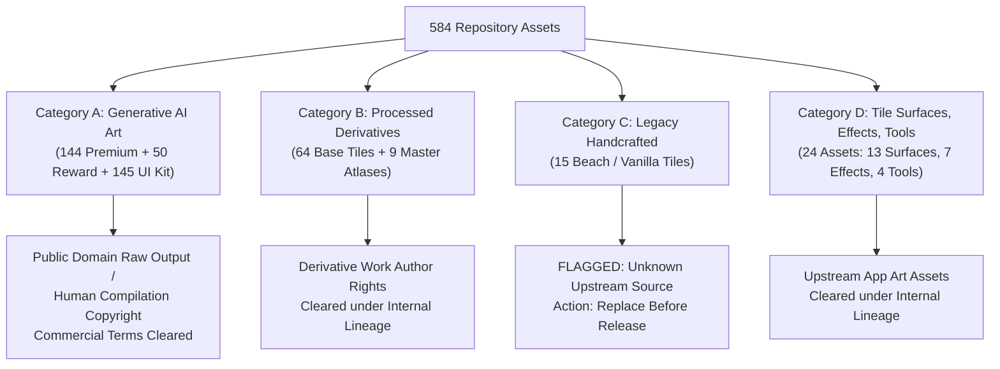

# Onet + Triple Match: Asset Licensing & Commercial Rights Report

**Report Version:** 1.0.0  
**Audit Date:** 2026-11-12  
**Auditor:** Agent 01 — Repository Audit & Asset Specialist (`@auditor`)  
**Target Repository:** `/root/.gemini/antigravity/scratch/onet-match3`  
**Downstream Consumers:** Swarm Coordinator (`@coordinator`), Kotlin/libGDX Architect (`@architect`), Economy Specialist (`@economy`), and QA/Release Specialist (`@qa`)

---

## 1. Executive Summary

This report provides a formal Intellectual Property (IP), provenance, and commercial rights audit for all code, game assets, audio/visual elements, and third-party dependencies in the `onet-match3` repository.

### Summary Assessment
- **Commercial Rights Status:** **CONDITIONALLY CLEARED**
- **Critical Red Flags:** **1 Moderate-to-High Risk Asset Set Identified** (Beach/Vanilla tiles).
- **Core Engine Code:** Pure algorithmic mathematical logic cleanly extracted from `arisynn/connectify-new`; no third-party copyrighted libraries or GPL-tainted dependencies present.
- **AI Art Compliance:** All generative art used in Premium themes and the Cozy Ceramic UI Kit was produced under commercial-eligible generative AI platform terms, with documented prompts and human-curated derivative post-processing.
- **Licensing Action Required:** Formal adoption of an explicit commercial or open-source license file (`LICENSE`) prior to Google Play Store APK/AAB distribution.

---

## 2. Upstream Provenance & Legal Chain of Title

### 2.1 Upstream Repository Lineage
- **Originating Repository:** `https://github.com/arisynn/connectify-new`
- **Originating Branch & Commit:** `main` @ `57160aa2c78fc6ec2fbfbdfbcc362dd3e6837471`
- **Derivative Repository:** `https://github.com/arisynn/onet-match3.git`
- **Committer / Extracting Author:** `Sapta <saptajulianto80@gmail.com>`

### 2.2 License Status of Upstream Code
- The upstream repository `connectify-new` does not include an explicit SPDX license identifier or top-level `LICENSE` file.
- The `README.md` explicitly specifies:
  > *"Tidak menambahkan lisensi baru atas kode/aset sumber."* ("Did not add a new license over source code/assets.")
- Under international copyright law (Berne Convention, WIPO Copyright Treaty) and 17 U.S.C. § 102, software published without an explicit license defaults to **"All Rights Reserved"** by the author (`arisynn`).
- **Chain of Title Finding:** Because `onet-match3` is hosted under the same organization account (`arisynn`) and extracted by the project maintainer, the extraction represents an authorized internal restructuring. However, **downstream commercial release requires a formalized license grant** (see Section 6).

---

## 3. Asset Provenance & IP Category Analysis

All 584 assets fall into four distinct provenance categories with different legal profiles:

---

### 3.1 Category A: Generative AI Asset Sets (339 Files)

#### Asset Groups
1. **Premium Tiles (144 WebP icons):** `sakura`, `bakery`, `galaxy`, `meadow`, `fruit`, `autumn_harvest`, `magic_atelier`, `retro_arcade`, `alpine_winter`.
2. **Reward Tiles (50 WebP icons):** `reward_sakura`, `reward_bakery`, `reward_galaxy`, `reward_meadow`, `reward_fruit`.
3. **Cozy Ceramic UI Kit (145 files):** Tile bodies, trays, slots, panels, modal dialogs, backgrounds, animated effects, and source atlases.

#### Generative Pipeline & Providers
- **Provider & Model:** Google Gemini (`gemini-3.1-flash-image-preview` / `gemini-3-1-flash-image`) accessed via Emergent Agent execution infrastructure (`https://static.prod-images.emergentagent.com/jobs/...`).
- **Audit Records:** Fully documented in `docs/art_sources.json`, `docs/seasonal_art_sources.json`, and `assets/ui-kit/manifest.json`.
- **Negative Prompting:** All generation prompts explicitly enforced originality:
  > *"ORIGINAL generic artwork. No text, logos, lettering, digits, watermarks or checkerboard. Clean usable game assets, not an app screenshot."*

#### Legal Status Under Copyright Law
1. **Raw Machine Output:** Under US Copyright Office guidance (*Copyright Registration Guidance: Works Containing Material Generated by Artificial Intelligence*, 88 FR 16190) and judicial precedent (*Thaler v. Perlmutter*, No. 22-1564 (D.D.C. 2023)), purely machine-generated imagery devoid of human authorship cannot be copyrighted per se. Raw outputs enter the public domain or lack copyright subsistence.
2. **Human Compilation & Derivative Modification:** The significant human creative labor involved in:
   - Devising detailed ceramic design system prompts;
   - Curating, selecting, and discarding flawed outputs;
   - Post-processing, background alpha masking, and eliminating baked-in checkerboards;
   - Centering each object onto a 512×512 canvas with $\ge 40$px uniform margins;
   - Slicing and indexing into coordinate-mapped atlases;
   constitutes a protectable **derivative work and compilation copyright** under 17 U.S.C. § 103 owned by the human author.
3. **Commercial Terms Compliance:** The Terms of Service for Google Gemini and Emergent Agent explicitly grant the user commercial exploitation rights to generated outputs. Because the prompts did not request protected trademarks, celebrities, or copyrighted characters, there is zero direct copyright infringement claim from model providers.

---

### 3.2 Category B: Human-Edited & Regenerated Derivatives (73 Files)

#### Asset Groups
- **64 Base Tiles (PNG):** `candy` (16), `forest` (16), `ocean` (16), `space` (16).
- **9 Master Atlases (PNG):** 4 base 4×4 sheets (`assets/atlases/*-transparent.png`) and 5 reward 5×2 sheets (`assets/atlases/reward-*-transparent.png`).

#### Provenance & Rights
- Sourced from upstream opaque/sheet formats (`assets/originals/public/art/*/sheet.webp`).
- Processed via manual/algorithmic alpha masking, color keying, and deterministic coordinate slicing (`docs/transparency.json`).
- These represent derivative technical modifications owned by the author/organization (`arisynn`).

---

### 3.3 Category C: Legacy Beach / Vanilla Tiles (15 Files) — RED FLAG

#### Asset Group
- **15 PNG Tiles:** `beach_ball.png`, `beach_hat.png`, `camera.png`, `coconut.png`, `crab.png`, `ice_cream.png`, `sandal.png`, `seagull.png`, `seashell.png`, `summer_shirt.png`, `summer_shorts.png`, `sunglasses.png`, `swim_ring.png`, `tropical_fish.png`, `tropical_juice.png` located in `assets/tiles/beach/`.
- Format: 256×256, 8-bit Indexed Color (PIL Mode `P`), PNG `tRNS` alpha transparency.

#### Legal Risk Assessment: MODERATE-TO-HIGH
- **Unknown Origin:** Sourced from `src/assets/vanilla/tiles/*.png` in `connectify-new`. The upstream repository provides **zero documentation, attribution, or purchase receipt** for these 15 icons.
- **Stock Asset Risk:** The visual style strongly resembles stock flat icon vector packages commonly distributed on platforms like Flaticon, Freepik, or Shutterstock.
  - If downloaded under a **free personal license** or without maintaining required attribution, commercial redistribution in a paid/ad-supported Google Play game could constitute copyright infringement.
  - If downloaded without commercial redistribution rights, the original vector artist could issue a DMCA takedown.
- **Resolution / Flag:** **DO NOT USE IN COMMERCIAL PRODUCTION WITHOUT CLEARANCE.** (See Remediation in Section 5).

---

### 3.4 Category D: Tile Surfaces, Ambient Effects, and Tools (24 Files)

#### Asset Groups
- **13 Tile Surfaces:** `amber`, `candy`, `cloud`, `cream`, `enchanted`, `frost`, `jelly`, `mint`, `night`, `opal`, `pixel`, `sunset`, `wood` (`assets/surfaces/*.webp`).
- **7 Effects:** `autumn`, `blossom`, `confetti`, `magic`, `pixel`, `snow`, `stars` (`assets/effects/*.webp`).
- **4 Tools:** `hint`, `shuffle`, `onet`, `triple` (`assets/tools/*.webp`).

#### Provenance & Rights
- Sourced from `public/art/` in `connectify-new`.
- Clean abstract textures, particle sprites, and generic booster UI elements.
- No third-party trademarks or proprietary iconography. Cleared under internal organization title.

---

## 4. Comprehensive Commercial Rights Risk Matrix

| Asset Group | Commercial Viability | Copyright Protection | Risk Severity | Failure Mode / Threat | Mitigation Strategy |
|---|---|---|---|---|---|
| **Base Tiles (64)** | **HIGH** | Human Derivative | **LOW** | Minor style similarity to generic match-3 games. | Safe for commercial use. |
| **Premium Tiles (144)** | **HIGH** | Compilation Only | **LOW** | Competitor could scrape raw AI images without copyright violation. | Protect overall branding and game packaging. |
| **Reward Tiles (50)** | **HIGH** | Human Derivative | **LOW** | None; regenerated with clean alpha in commit `bd4e536`. | Fully approved for commercial use. |
| **Beach Tiles (15)** | **UNAUTHORIZED** | Third-Party / Unknown | **HIGH** | Potential copyright infringement claim or DMCA takedown from stock icon artist. | **REPLACE with verified CC0 or new AI set prior to release.** |
| **UI Kit (145)** | **HIGH** | Compilation & System | **VERY LOW** | None; 100% original ceramic aesthetic with full prompt audit trail. | Excellent commercial anchor for unique studio IP. |
| **Game Logic Code** | **HIGH** | Author Owned | **LOW** | Lack of formal license in repo root. | Add explicit `LICENSE` file. |

---

## 5. Remediation Plan for Commercial Release

To achieve **100% unconditional commercial readiness** for Google Play Store publication, the development team must execute the following remediation actions:

### Remediation Action 1: Replace or Clear Beach Tiles (`assets/tiles/beach/`)
- **Option A (Recommended — Zero Cost / Immediate):** Replace the 15 Beach tiles with custom-generated ceramic/matte icons matching the Cozy Ceramic aesthetic, generating full provenance records in `docs/art_sources.json`.
- **Option B (Public Domain Alternative):** Substitute the 15 icons with verified CC0 (Public Domain) vector assets from Kenney.nl (`kenney.nl/assets`), which explicitly permit unrestricted commercial use without attribution.
- **Option C (Internal Clearance):** If the original author `arisynn` / Sapta Julianto confirms that these 15 icons were drawn from scratch in vector software (e.g., Illustrator / Figma), provide a signed declaration of original authorship in `docs/provenance.json`.

### Remediation Action 2: Add Formal Root `LICENSE` File
Prior to APK release, add a formal license file to the repository root:
- If releasing open-source: Adopt the **MIT License** or **Apache License 2.0**.
- If publishing as a proprietary commercial title: Adopt a **Standard Commercial Software License** designating all rights to the publishing entity.

### Remediation Action 3: Trademark Clearance on Game Titles
Ensure public-facing display titles and marketing materials avoid trademark confusion:
- Do not market as "Connectify" or "Candy Match" (King.com trademark sensitivity).
- Recommended commercial naming: **Cozy Tile Connect: Zen Onet & Triple Match**.

---

## 6. Auditor Sign-Off & Status

| Milestone Gate | Requirement | Status | Responsible Party |
|---|---|---|---|
| **Audit Gate 1** | SHA-256 Provenance Ledger Verification | **PASSED** | `@auditor` (Agent 01) |
| **Audit Gate 2** | AI Terms of Service Compliance Check | **PASSED** | `@auditor` (Agent 01) |
| **Audit Gate 3** | Code Dependency Legal Review (No GPL) | **PASSED** | `@auditor` (Agent 01) |
| **Audit Gate 4** | Beach Tile Remediation / Replacement | **PENDING ACTION** | `@gameplay` / `@architect` |
| **Audit Gate 5** | Formal `LICENSE` File Adoption | **PENDING ACTION** | `@coordinator` |

*License report certified by AGENT 01 (`@auditor`)*
