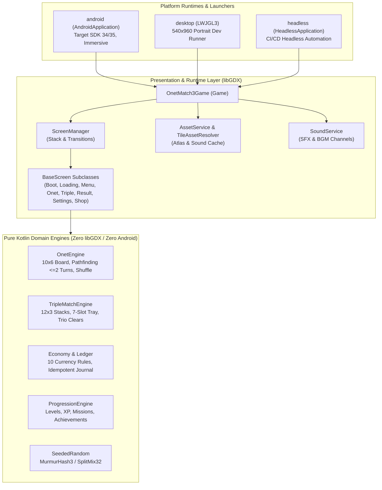
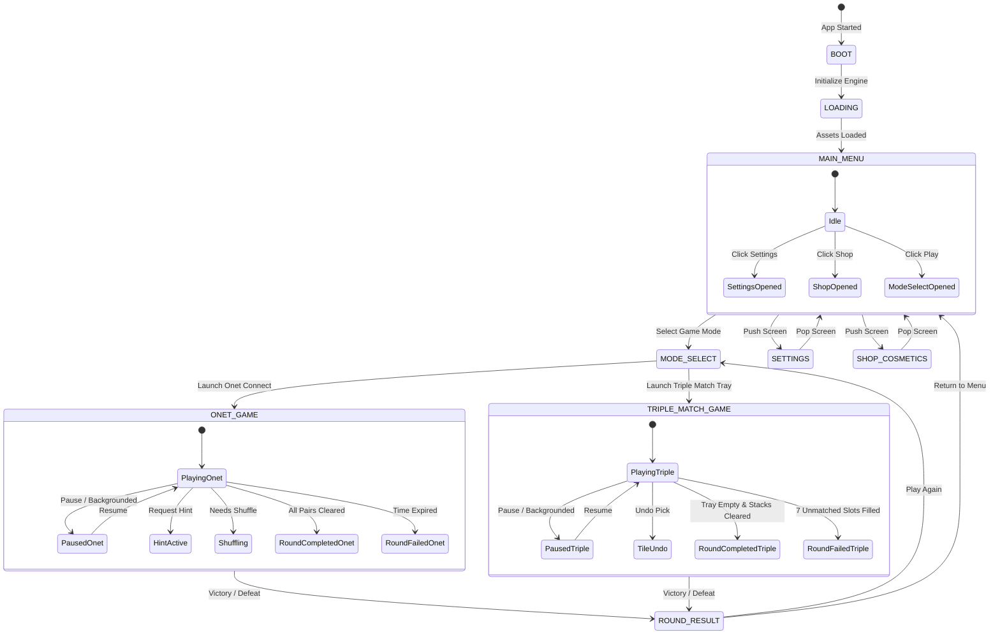

# Onet + Triple Match: System Architecture & Android Foundation

> [!IMPORTANT]
> This document defines the architectural foundation for the native Kotlin / libGDX port of **Onet + Triple Match**. It establishes clean layer boundaries, multi-module separation, screen lifecycle management, and asset resolution across Android and Desktop platforms.

---

## 1. Executive Architectural Overview

The application is structured as a multi-module Kotlin project driven by Gradle Kotlin DSL (`.gradle.kts`), targeting **libGDX 1.13.1**, **Kotlin 2.0+**, and **Android API 34/35 (minSdk 24)**.



### Core Architecture Principles

1. **Zero-Dependency Domain Core**: The pure logic for Onet matching, Triple Match tray resolution, seeded random generators, player progression, economy rules, and ledger transactions resides in pure Kotlin classes with zero dependencies on Android, libGDX graphics, DOM, or networking. This allows 100% of game rules to be verified via instant unit tests.
2. **Platform Abstraction**: All platform-specific interactions (Android activity lifecycle, immersive mode, touch input, audio output, file storage) are abstracted behind libGDX application listeners and decoupled domain interfaces.
3. **Screen Stack & Modal Navigation**: A centralized `ScreenManager` controls transitions between game screens, supporting both replacement transitions (e.g. Boot -> Loading -> Main Menu) and modal stacking (e.g. pushing Settings or Round Result on top of an active match without resetting match state).
4. **Deterministic Simulation & Seeded Random**: Deterministic pseudo-random number generation (`SeededRandom` using MurmurHash3 / SplitMix32) ensures reproducible board generation, predictable hint solving, and verifiable economy simulations.

---

## 2. Multi-Module Project Structure

| Module | Build Plugin | Responsibilities | Target JVM / SDK |
| :--- | :--- | :--- | :--- |
| **`:core`** | `kotlin("jvm")` | Pure domain engines (Onet, Triple Match, Economy, Progression) + libGDX presentation (Screens, Viewports, AssetService, Game Bootstrap). | JVM 17 |
| **`:android`** | `com.android.application`<br/>`kotlin("android")` | Android launcher (`AndroidLauncher`), AndroidManifest, portrait locking, hardware acceleration, JNI native `.so` packaging (`arm64-v8a`, `armeabi-v7a`, `x86`, `x86_64`), asset bundling. | CompileSdk 35<br/>TargetSdk 35<br/>MinSdk 24 |
| **`:desktop`** | `kotlin("jvm")`<br/>`application` | Desktop runner (`DesktopLauncher`) using LWJGL3 backend for rapid developer iteration, windowed 540x960 portrait emulation, 60 FPS foreground loop. | JVM 17 |
| **`:headless`** | `kotlin("jvm")` | Headless execution runner using `gdx-backend-headless` for fast automated integration tests without display servers. | JVM 17 |

---

## 3. Screen Lifecycle & Navigation Architecture



### Screen Management Protocol

1. **`BaseScreen`**: All screens inherit from `BaseScreen`, which implements `com.badlogic.gdx.Screen` and encapsulates:
   - Orthographic camera and virtual viewport (540x960 portrait).
   - Input multiplexer with clean processor detachment on hide.
   - Clamped delta time (`delta.coerceIn(0f, 0.1f)`) to guard against frame hitches.
   - Idempotent disposal safeguarding against double-free errors.
2. **`ScreenManager`**:
   - `setScreen(ScreenType, transition)`: Replaces the current active screen with a transition (e.g. `FadeTransition`, `InstantTransition`).
   - `pushScreen(ScreenType, transition)`: Pauses and hides the active screen without disposing it, pushing it onto `screenStack`.
   - `popScreen(transition)`: Disposes the top screen and resumes the previous screen in the stack, restoring exact board state.

---

## 4. Asset Resolution & Rendering Pipeline

### Asset Hierarchy

Game assets are organized in `/root/.gemini/antigravity/scratch/onet-match3/assets/`:
- `tiles/`: 273 individual tile graphics:
  - Base themes (`candy`, `ocean`, `forest`, `space`): 64 transparent PNGs (512x512).
  - Premium themes (`sakura`, `bakery`, `galaxy`, `meadow`, `fruit`, `autumn_harvest`, `magic_atelier`, `retro_arcade`, `alpine_winter`): 144 WebP tiles.
  - Reward sets (`reward_sakura`, `reward_bakery`, `reward_galaxy`, `reward_meadow`, `reward_fruit`): 50 cleaned 512x512 WebP tiles.
  - Beach/Sweets set: 15 PNG tiles.
- `atlases/`: 9 transparent texture atlases for high-performance batch rendering.
- `surfaces/`, `effects/`, `tools/`: Tile frames, glow effects, hints, and shuffle buttons.
- Cozy Ceramic UI Kit: 122 modular UI assets (bodies, trays, panels, badges) and 4 animated WebP sequences.

### `TileAssetResolver` Contract

The `TileAssetResolver` acts as a pure mapper between logical tile identifiers and filesystem/atlas assets:
```kotlin
val path = TileAssetResolver.tileAssetFor("candy_0") // "assets/tiles/candy/0.png"
val reward = TileAssetResolver.tileAssetFor("reward_sakura_3") // "assets/tiles/reward_sakura/3.webp"
val beach = TileAssetResolver.tileAssetFor("beach_ball") // "assets/tiles/beach/beach_ball.png"
```

In the Android build, Gradle links `assets.srcDirs(files("../assets"))`, ensuring zero disk duplication while enabling direct APK packaging.

---

## 5. Domain Engine Integration

### Onet Connect Engine
- **Board Grid**: 10 columns by 6 rows.
- **Pathfinding**: BFS / raycast search enforcing $\le 2$ turns (direct line, 1 turn, or 2 turns). Paths may travel outside the active board bounds via a virtual outer boundary.
- **Game Loop State**:
  - `round.event`: Holds transient animation path and duration (480 ms).
  - `pending`: Locks user input while match resolution is underway.
  - `needsShuffle()`: Triggers board reshuffle when no legal $\le 2$-turn pairs exist.

### Triple Match Tray Engine
- **Stack Generation**: 12 stacks $\times$ 3 layers (36 tiles total), guaranteed to contain exact multiples of 3 for every tile ID.
- **Tray Mechanic**: 7-slot collection tray.
- **Trio Resolution Rule**: When a tile is picked into the 7th tray slot, trio matching is evaluated **before** checking tray overflow. If the 7th pick forms a 3-of-a-kind trio, the trio is cleared immediately, freeing 3 slots and keeping the player alive!
- **Single-Use Undo**: Single undo operation allowed per pick; does not refund elapsed timer.

---

## 6. Currency, Economy & Security Model

The economy strictly obeys the **10 Non-Negotiable Rules**:
1. **Coins** are earned via gameplay (matches, combos, stage clears).
2. **Gems** are earned **EXCLUSIVELY** by claiming completed missions and achievements.
3. Zero gems from direct board clears or level-up events.
4. Zero real-money direct currency purchases (no "pay-to-win" gem packs).
5. All transactions are logged to an **append-only idempotent ledger** (`TransactionLedger`).
6. Double-spend and duplicate claim attacks are rejected via unique transaction IDs and claim flags.
7. Real-money purchases are restricted to **non-consumable entitlements** (Ad Removal, VIP Theme Pack) verified via cryptographic signature validation.
8. Daily/weekly mission rollover and reset rules prevent stale reward accumulation.

---

## 7. Testing Strategy

1. **Unit Testing (`:core:test`)**:
   - Pure domain logic tests (Onet pathfinding, board shuffle, Triple Match tray overflow, trio clearing).
   - Currency rules and ledger immutability tests.
   - Seeded random repeatability tests across varying seeds.
2. **Headless Integration Testing (`:headless:test`)**:
   - `HeadlessApplication` launches `OnetMatch3Game`.
   - Screen switching, lifecycle transitions, and stack push/pop verification without display hardware.
   - Asset path resolution integrity across all 273 tile IDs.
3. **Android Build Verification (`:android:assembleDebug`)**:
   - Gradle build compilation, resource linking, Android manifest validation, and APK generation.
